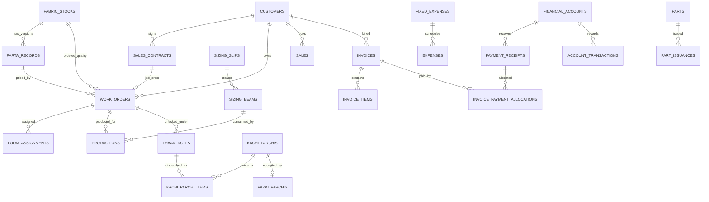

# LoomFlow Database Schema & Demo Data Guide

This document describes the **current application schema as assembled by the migrations in `database/migrations/`**. It is intended for preparing coherent demo or cloud-seeded data. Migrations remain the source of truth if this document and the database differ.

## Quick rules for demo data

- Run migrations first; do not create tables by hand. The default database configuration is MySQL.
- Let MySQL/Laravel generate `id`, `created_at`, and `updated_at` unless importing a deliberately coordinated fixture. Do not invent foreign-key IDs: insert parents first and use their returned IDs.
- Use unique values for `users.email`, `yarn_qualities.name`, `fabric_stocks.quality_name`, `parts.part_code`, `bag_purchases.challan_no`, `sizing_slips.slip_no`, `sizing_beams.beam_no`, `sales_contracts.contract_no`, `sales.slip_no`, `work_orders.order_no`, `thaan_rolls.roll_no`, all parchi/receipt/invoice numbers, and other declared unique keys.
- Use valid ISO dates (`YYYY-MM-DD`), booleans (`true`/`false`), decimal quantities, and valid enum-like strings listed below. Quantities and money should be JSON numbers, not formatted strings.
- Prefer creating operational records through the app/services because they update stock balances, derived totals, account transactions, and ledger postings. For raw demo imports, create all linked records consistently and do not add duplicate derived ledger lines.
- The only required seed order is the foreign-key order below. A realistic workflow order is: users and master data → customers/contracts/qualities → purchases and stock → sizing slips/beams → orders/loom assignment → production and checked rolls → dispatch/acceptance → invoices/payments/expenses.
- `ledgers` is a posting/report table. `balance` is a running balance for each party/type; source-tracked postings are unique by (`source_type`, `source_id`, `source_role`). Do not seed ledger rows as substitutes for their source transactions.

## Module map

| Module | Main tables |
| --- | --- |
| Authentication | `users` |
| Bags / yarn purchase and movement | `yarn_qualities`, `suppliers`, `bag_purchases`, `bag_transactions`, `yarn_movements` |
| Sizing and beams | `sizing_slips`, `sizing_beams`, `beam_events` |
| Parts store | `parts`, `part_issuances` |
| Fabric stock | `fabric_stocks`, `fabric_stock_movements`, `thaan_rolls` |
| Sales and customer contracts | `customers`, `sales_contracts`, `sales` |
| Factory orders, checking and dispatch | `parta_records`, `work_orders`, `loom_assignments`, `thaan_rolls`, `kachi_parchis`, `kachi_parchi_items`, `pakki_parchis`, `thaan_returns`, `thaan_dispositions`, `loom_stoppages` |
| Production | `productions`, `sizing_beams`, `loom_assignments`, `work_orders` |
| Invoices and receipts | `customers`, `invoices`, `invoice_items`, `payment_receipts`, `invoice_payment_allocations`, `financial_accounts`, `account_transactions` |
| Expenses | `fixed_expenses`, `expenses`, `financial_accounts`, `account_transactions` |
| Ledgers | `ledgers` |

## Relationships

Some relationships are deliberately nullable for historical or open records. `sales_contracts.work_order_id` is not a column; the one-to-one contract link is `work_orders.sales_contract_id`.

## Schema catalog

Types below use Laravel/MySQL names in plain form. `?` means nullable. Fields omitted from a row are not implied to exist. Most tables also include `id`, `created_at`, and `updated_at` unless stated otherwise.

### Authentication and shared masters

#### `users`

`name` string; `email` unique string; `role` string default `admin`; `email_verified_at` timestamp?; `password` hashed string; `remember_token` nullable token; timestamps.

#### `customers`

`name` string(150); `phone` string(50)? unique when supplied; `email` string?; `address` text?; `opening_balance` decimal(14,2) default 0; `status` string default `active`.

Referenced by sales contracts, work orders, sales, invoices, payment receipts, and selected ledger lines. Existing workflows often copy a buyer name into `buyer_name`/`party_name` too; keep the name consistent with `customer_id`.

#### `suppliers`

`name` string(150); `type` string(40) default `yarn_supplier`; `phone` string(60)?; `email` string(150)?; `address` text?; `opening_payable` decimal(14,2) default 0; `status` string(20) default `active`; unique (`name`,`type`); index (`type`,`status`). Supplier names in bag purchase rows are currently stored as text, not a supplier foreign key.

#### `yarn_qualities`

`name` string(100) unique; optional quality metadata: `construction` string?, `read` decimal(10,4)?, `pick` decimal(10,4)?, `warp_count` decimal(10,4)?, `weft_count` decimal(10,4)?, `width_inches` decimal(8,2)?, `unit_cost_meter` decimal(10,2)?, `warp_weight_per_meter_lb` decimal(12,4)?, `weft_weight_per_meter_lb` decimal(12,4)?, `total_weight_per_meter_lb` decimal(12,4)?. Shared master for yarn quality labels. Current operational rows also retain quality text for backwards compatibility.

### Bags, yarn, sizing, and beams

#### `bag_purchases`

`challan_no` indexed string; `supplier_name` string; `quality` string; `total_bags` decimal(12,2); `cones_per_bag` unsigned small integer?; `bags_to_sizing` decimal(12,2) default 0; `sizing_destination` string?; `bags_to_factory` decimal(12,2) default 0; `rate_per_bag` decimal(10,2); `total_amount` decimal(12,2); `expense_id` FK to `expenses`?; `purchase_date` date; `notes` text?. Bag quantities changed to decimals by later migrations.

#### `bag_transactions`

`transaction_type` string; `reference_no` indexed string?; `quality` string; `quantity_bags` decimal(12,2); `cones_per_bag` unsigned small integer?; `source` string default `Factory Store`; `destination` string default `Sizing Person`; `party_name` string?; `transaction_date` date; `notes` text?; `work_order_id` FK to `work_orders`?; `sales_contract_id` FK to `sales_contracts`?; `owner_type` string(12) default `factory`; `component` string(10)?; `net_weight_kg` decimal(14,3)?. Common transaction types include `purchase_factory`, `purchase_sizing`, `issue_to_sizing`, `return_from_sizing`, and `issue_to_loom`; validate against current controller rules before importing.

#### `sizing_slips`

`slip_no` unique string; `slip_type` string(20) default `raw_perch`; `sizing_party` string; `yarn_quality` string; `bags_allocated`, `bags_used`, `bags_returned_to_factory`, `bags_held_with_sizing` decimals(12,2); `total_beams` unsigned integer default 1; `set_length_value` decimal(12,2)?; `set_length_unit` string(20) default `meters`; `total_ends` unsigned integer?; `reed_count` unsigned integer?; `fabric_width_inches` decimal(8,2)?; `selvedge_ends` unsigned integer default 0; `width_multiplier` decimal(6,3) default 1; `total_length_meters` decimal(10,2) default 0; `sizing_weight_pounds` decimal(10,2)?; `sizing_gross_weight_pounds` decimal(10,2)?; `bag_transaction_id` unique FK to `bag_transactions`?; `work_order_id` FK to `work_orders`?; gate-pass returned-material fields: `wet_cone_bags` unsigned integer, `wet_cone_weight_kg` decimal(12,2), `empty_bag_count` unsigned integer, `empty_bag_weight_kg` decimal(12,2), `paper_bag_count` unsigned integer, `paper_bag_weight_kg` decimal(12,2), `sound_cone_count` unsigned integer, `sound_cone_weight_kg` decimal(12,2), `carton_count` unsigned integer, `carton_weight_kg` decimal(12,2), `returned_materials_weight_kg` decimal(12,2), `sizing_rate_per_kg` decimal(12,2)?, `sizing_bill_amount` decimal(14,2)?; `slip_date` date; `status` string default `completed`; `notes` text?. Numeric fields not marked nullable are non-null and default as shown by migration.

#### `sizing_beams`

`sizing_slip_id` FK to `sizing_slips`?; `fabric_stock_id` FK to `fabric_stocks`?; `work_order_id` FK to `work_orders`?; `beam_no` unique string; `beam_name` string?; `yarn_quality` string; `total_length_meters`, `remaining_length_meters` decimals(10,2); `initial_net_weight_kg` decimal(14,3)?; `assigned_loom_no` indexed string?; `status` string default `ready_in_store` (`ready_in_store`, `mounted_on_loom`, `exhausted`); `mounted_date` date?; `notes` text?.

#### `yarn_movements`

`work_order_id` FK; `component` string (`warp`/`weft`); `owner_type` string (`customer`/`factory`); `movement_type` string (`receipt`, `issue`, `return`, `adjustment_in`, `adjustment_out`); `weight_kg` decimal(14,3); `bags` decimal(14,2)?; `yarn_count` string(80)?; `lot_no` string(100)?; `reference_no` string(100)?; `movement_date` date; `destination_type` string(20) default `factory_store`; `destination_name` string?; `notes` text?; index (`work_order_id`,`component`,`owner_type`).

#### `beam_events`

`sizing_beam_id` FK; `from_work_order_id`, `to_work_order_id` FKs to work orders?; `from_loom`, `to_loom` strings?; `action` string (`mount`, `unmount`, `settle_reassign`); `remaining_length_meters` decimal(14,2); `estimated_weight_kg` decimal(14,3)?; `predicted_settlement`, `agreed_settlement` decimals(14,2)?; `event_date` date; `notes` text?.

### Parts and fabric stock

#### `parts`

`part_name` string; `part_code` unique string; `category` string default `Mechanical`; `stock_quantity` integer default 0; `min_alert_threshold` integer default 5; `unit` string default `pcs`; `unit_price` decimal(10,2) default 0; `rack_location` string?; `notes` text?.

#### `part_issuances`

`part_id` FK to `parts` (cascade delete); `loom_no` indexed string; `issued_to_person` string; `quantity` integer; `unit_price` decimal(10,2) default 0; `total_cost` decimal(12,2) default 0; `issuance_date` date; `remarks` text?.

#### `fabric_stocks`

`quality_name` unique string; `construction` string?; `area` string(100)?; `width_inches` decimal(6,2) default 63; `read`, `pick`, `warp_count`, `weft_count` decimals(10,4)?; `warp_weight_per_meter_lb`, `weft_weight_per_meter_lb`, `total_weight_per_meter_lb` decimals(12,4)?; `total_meters_produced`, `current_stock_meters`, `committed_contract_meters`, `available_open_meters` decimals(12,2); `daily_received_meters` decimal(12,2) default 0; `total_rolls_in_stock` integer default 0; `unit_cost_meter` decimal(10,2) default 0; `notes` text?.

#### `fabric_stock_movements`

`fabric_stock_id` FK to `fabric_stocks` (cascade delete); `movement_date` date; `previous_stock_meters`, `received_meters`, `adjustment_meters`, `dispatch_meters`, `closing_stock_meters` decimals(14,2); `rolls_received` unsigned integer default 0; `area` string(100)?; `remarks` text?; unique (`fabric_stock_id`,`movement_date`).

### Sales, factory, checking, and production

#### `sales_contracts`

`customer_id` FK to `customers`?; `fabric_stock_id` FK to `fabric_stocks`?; `contract_no` unique string; `party_contract_no` string(80)?; `buyer_name` string; `buyer_phone` string?; buyer/contract metadata: `buyer_code`, `buyer_gst`, `broker_code`, `broker_name`, `quality_code`, `contract_quality` strings?; `contract_type` string default `Conversion`; `loom_type` string?; `contract_quality_width` decimal(12,3)?; `fabric_quality` string; `total_meters`, `delivered_meters`, `remaining_meters`, `accepted_meters` decimals(12,2); `rate_per_meter` decimal(10,2); `total_amount` decimal(12,2); `start_date` date; `end_date` date?; `status` string (`active`, `completed`, `cancelled`); costing inputs include `panna`, `kp_percentage`, `kp_days`, `pp_percentage`, `pp_days`, `read`, `pick`, `warp_count`, `weft_count`, `width`, yarn rates, `conversion_rate`, calculated weight/bag/cost/tax snapshots; `yarn_supply` string; `tax_enabled` boolean; delivery/payment/quality/other instruction text?; `notes` text?. Exact field names for costing snapshots: `broker_commission_per_meter`, `warp_wt_40m`, `weft_wt_40m`, `warp_weight_1m`, `weft_weight_1m`, `total_weight_1m_lb`, `total_weight_1m_kg`, `width_m`, `gsm`, `warp_bags`, `weft_bags`, `warp_amount_per_mtr`, `weft_amount_per_mtr`, `conversion_per_mtr`, `yarn_value`, `conv_value`, `sale_tax_rate`, `sales_tax_amount`.

#### `sales`

`customer_id` FK?; `sales_contract_id` FK?; `fabric_stock_id` FK?; `slip_no` unique string; `sale_type` string default `open_market` (`open_market`, `contract`); `buyer_name` string; `buyer_phone` string?; `fabric_quality` string; `meters_sold` decimal(12,2); `rolls_sold` integer default 1; `rate_per_meter` decimal(10,2); `subtotal` decimal(12,2); `discount` decimal(10,2) default 0; `net_total` decimal(12,2); `cost_per_meter` decimal(14,4)?; `cost_of_goods_sold` decimal(14,2)?; `payment_type` string default `credit`; `payment_status` string default `paid`; `sale_date` date; `vehicle_no` string?; `notes` text?.

#### `parta_records`

`fabric_stock_id` FK to `fabric_stocks` (restrict delete); `version` integer default 1; `read`, `pick`, `width_inches` decimals(12,3); `warp_count`, `weft_count` decimals(12,4); `warp_rate_per_lb`, `weft_rate_per_lb`, `conversion_rate_per_pick` decimals(14,4); calculated `warp_lb_per_meter`, `weft_lb_per_meter`, `total_lb_per_meter`, `kg_per_meter` decimals(14,6); `grams_per_meter`, `gsm` decimals(14,3); `cost_per_meter` decimal(14,4); unique (`fabric_stock_id`,`version`).

#### `work_orders`

`customer_id` FK to `customers`?; `sales_contract_id` unique FK to `sales_contracts`?; `fabric_stock_id` FK to `fabric_stocks`; `parta_record_id` FK to `parta_records`?; `order_no` unique string; `type` string (`own`, `job`); `party_name` string?; `target_meters` decimal(14,2)?; `accepted_meters` decimal(14,2) default 0; `rate_per_pick` decimal(14,4) default 0; `warp_supply`, `weft_supply` strings default `factory` (`customer`, `factory`, `mixed`); `status` string default `active` (`active`, `fulfilled`, `closed`); `start_date` date; `closed_on` date?; `closure_reason`, `notes` text?.

#### `loom_assignments`

`work_order_id` FK to `work_orders`; `loom_no` string(50); `start_date` date; `end_date` date?; `change_reason` text?; index (`loom_no`,`start_date`,`end_date`). An active assignment has `end_date = null`.

#### `productions`

`work_order_id` FK?; `loom_assignment_id` FK?; `sizing_beam_id` FK?; `fabric_stock_id` FK?; `production_date` date; `shift` string default `Day`; `loom_no` indexed string; `operator_name` string; `fabric_quality` string; `start_meter`, `end_meter` decimals(10,2); `net_meters_produced`, `beam_meters_consumed`, `expected_fabric_meters` decimals; `leakage_waste_meters` decimal(10,2) default 0; `leakage_percentage` decimal(5,2) default 0; `picks_per_inch` integer default 60; `rpm` integer default 350; `efficiency_percentage` decimal(5,2) default 85; optional roll-count snapshot `gazana_per_roll` decimal(12,2)?, `roll_quantity` unsigned integer?, `total_gazana` decimal(14,2)?; `is_provisional` boolean default true; `remarks` text?.

#### `thaan_rolls`

`roll_no` unique string; `work_order_id`, `fabric_stock_id` FKs; `loom_no` string(50); `production_date` date?; `checked_on` date; `length_meters` decimal(14,2); `grade` string(12) default `A`; `status` string default `ready` (`ready`, `dispatched`, `returned_hold`, `returned_ready`, `disposed`, `accepted`); `owner_type` string(12) default `factory`; `notes` text?; index (`work_order_id`,`status`).

#### `kachi_parchis`

`parchi_no` unique string; `work_order_id` FK; `dispatch_date` date; `dispatched_meters` decimal(14,2) default 0; `thaan_count` unsigned integer default 0; `vehicle_no` string?; `notes` text?.

#### `kachi_parchi_items`

`kachi_parchi_id` FK (cascade delete); `thaan_roll_id` FK; `length_meters` decimal(14,2); unique (`kachi_parchi_id`,`thaan_roll_id`).

#### `pakki_parchis`

`parchi_no` unique string; `kachi_parchi_id` unique FK; `invoice_id` unique FK?; `received_date` date; `accepted_thaans` unsigned integer; `accepted_meters`, `rejected_meters` decimals(14,2); `bill_amount` decimal(14,2) default 0; `notes` text?.

#### `thaan_returns`

`kachi_parchi_id`, `thaan_roll_id` FKs; `returned_on` date; unique (`kachi_parchi_id`,`thaan_roll_id`).

#### `thaan_dispositions`

`thaan_roll_id`, `from_work_order_id` FKs; `to_work_order_id` FK?; `action` string (`resend_a`, `return_customer`, `settle_keep`, `sell_approved`, `carry_forward`); `settlement_amount` decimal(14,2)?; `approval_reference` string?; `action_date` date; `notes` text?.

#### `loom_stoppages`

`loom_no` string(50); `work_order_id` FK?; `stopped_on` date; `downtime_minutes` unsigned integer; `reason` string(150); `repair_cost` decimal(14,2) default 0; `notes` text?.

#### `factory_worker_wages`

Legacy wage table: `worker_name` string(150); `work_order_id` FK?; `loom_no` string(50)?; `wage_date` date; `basis` string (`metre`, `day`, `fixed`); `quantity` decimal(14,3) default 1; `rate` decimal(14,4); `gross_amount`, `advance_adjustment`, `paid_amount`, `balance_amount` decimals(14,2); `notes` text?; index (`worker_name`,`wage_date`). This table is separate from expenses/account payments.

### Invoices, accounts, expenses, and ledgers

#### `financial_accounts`

`name` string(120); `type` string(20) (`cash` or `bank`); `account_number` string(80)?; `opening_balance` decimal(14,2) default 0; `is_active` boolean default true.

#### `invoices`

`invoice_no` unique string(100); `customer_id` FK to `customers` (restrict delete); `sales_contract_id` FK?; `sale_id` unique FK to `sales`?; `invoice_date` date; `due_date` date?; `subtotal`, `discount`, `total` decimals(14,2); `status` string default `issued`; `notes` text?.

#### `invoice_items`

`invoice_id` FK to `invoices` (cascade delete); `description` string(200); `quantity` decimal(14,3); `unit` string(30) default `Meter`; `rate`, `amount` decimals(14,2).

#### `payment_receipts`

`receipt_no` unique string(100); `customer_id`, `financial_account_id` FKs (restrict delete); `payment_date` date; `amount` decimal(14,2); `method` string(40); `reference` string(120)?; `notes` text?.

#### `invoice_payment_allocations`

`payment_receipt_id` FK (cascade delete); `invoice_id` FK (restrict delete); `amount` decimal(14,2); unique (`payment_receipt_id`,`invoice_id`). A receipt can be split over multiple invoices, or be left unallocated as customer credit according to app behavior.

#### `account_transactions`

`financial_account_id` FK (restrict delete); `payment_receipt_id` unique FK?; `expense_id` unique FK?; `transaction_date` date; `direction` string (`in`/`out`); `amount` decimal(14,2); `description` string(200); `reference` string(120)?; `party_name` string(150)?; `party_type` string(40)?; `notes` text?. Customer receipts and recorded expenses can create linked transactions; avoid inserting a second transaction for the same linked receipt/expense.

#### `fixed_expenses`

`name` string(150); `payee` string(150)?; `default_amount` decimal(14,2); `frequency` string(20) default `monthly`; `due_day` unsigned tiny integer?; `is_active` boolean default true; `notes` text?; index (`is_active`,`frequency`).

#### `expenses`

`fixed_expense_id` FK?; `financial_account_id` FK (restrict delete); `expense_type` string(20); `title` string(150); `expense_date` date; `amount` decimal(14,2); `payee` string(150)?; `reference` string(120)?; `notes` text?; index (`expense_date`,`expense_type`).

#### `ledgers`

`customer_id` FK to `customers`?; `party_name` indexed string; `party_type` string (examples: `yarn_supplier`, `sizing_mill`, `fabric_buyer`, `parts_vendor`, `general`, `expense`, `inventory`, `equity`); `transaction_date` date; `voucher_no` string?; `description` string; `debit`, `credit`, `balance` decimals(12,2); `notes` text?; source columns `source_type` string?, `source_id` unsigned bigint?, `source_role` string(40)?; unique (`source_type`,`source_id`,`source_role`); `is_migrated_legacy` boolean default false; `legacy_debit`, `legacy_credit`, `legacy_balance` decimals(14,2)?.

## Demo-data integrity notes

1. **Create shared master records first.** Add customers, suppliers, yarn qualities, fabric qualities, and financial accounts before transactions that refer to them.
2. **Fabric qualities are `fabric_stocks` rows.** Link `parta_records`, `work_orders`, `sales`, `sales_contracts`, beams, and checked rolls by `fabric_stock_id` when the FK exists; keep legacy text quality fields aligned.
3. **Make each order coherent.** A job order normally links one customer and one sales contract; an own order has `type=own`. Set matching `fabric_stock_id`, optional Parta version, target, yarn ownership, and active status. `sales_contracts` has a unique contract number; each contract can be linked to at most one work order.
4. **Keep sizing balances plausible.** A sizing slip's allocated bags should reconcile to used + returned + held according to the recorded workflow. Beam `remaining_length_meters` must be between 0 and its total length. A mounted beam should have a loom and mount event/assignment consistent with production.
5. **Keep production and checking aligned.** Production should point at the matching work order, loom assignment, beam, and fabric quality. `net_meters_produced` is the recorded shift output; `expected_fabric_meters`, beam consumption, leakage, and optional gazana values should be internally consistent. Checked roll lengths should not exceed the applicable output without a deliberate explanation.
6. **Keep stock transitions consistent.** Dispatch items must point to rolls belonging to the selected job order; their lengths should sum to the Kachi dispatched total. A Pakki record is unique per Kachi. Returns and dispositions must refer to real dispatched/returned rolls.
7. **Keep finance balanced.** Invoice item amounts should sum to invoice subtotal; invoice total should reflect discount. Payment allocations must not exceed a receipt or an invoice's remaining due. The linked account transaction must have the same amount/account/date and the appropriate direction. Expenses are outgoing transactions.
8. **Do not mix display snapshots with source transactions.** Counts and stock summary values are often derived or maintained from operational movements. Seed their source records and use application posting services for realistic demo data; otherwise the dashboard, inventory, and ledger can disagree.

## Seed order (foreign keys)

For a full end-to-end fixture, a safe topological order is:

1. `users`, `customers`, `suppliers`, `yarn_qualities`, `financial_accounts`, `fixed_expenses`, `parts`, base `fabric_stocks`.
2. `parta_records`, `sales_contracts`, `bag_purchases`, initial `bag_transactions`, `fabric_stock_movements`, `sales`.
3. `work_orders` (contracts first if the work order references them), `sizing_slips`, then `sizing_beams`.
4. `loom_assignments`, `beam_events`, `yarn_movements`, `productions`, `thaan_rolls`, `part_issuances`, `loom_stoppages`.
5. `kachi_parchis`, `kachi_parchi_items`, `thaan_returns`, `thaan_dispositions`, `pakki_parchis`.
6. `invoices`, `invoice_items`, `payment_receipts`, `invoice_payment_allocations`, `expenses`, and their linked `account_transactions`.
7. Add/update `ledgers` through the ledger posting service after their source transactions exist. Never assume seeded IDs match: preserve the returned parent IDs at each step.

This order may be adjusted for independent records, but parent rows must exist before their foreign keys are inserted. Circular-looking business workflows should be created in separate passes: create the contract first, create its work order, then add production/dispatch, and finally create any invoice linked back from a Pakki acceptance.

## Framework tables

Laravel may also use framework tables such as `migrations`, `cache`, `cache_locks`, `sessions`, `jobs`, `job_batches`, and `failed_jobs`, depending on configured drivers and which framework migrations have run. They are infrastructure tables, not LoomFlow business records, and should not be populated with mill demo transactions.

## Migration source

The detailed and authoritative column definitions are distributed across `database/migrations/`; later migrations extend earlier tables. When fields are added or renamed, update this guide alongside the migration. Existing module-level guides describe form behavior and calculations: see `BAGS_MODULE_README.md`, `SIZING_MODULE_README.md`, `PARTS_MODULE_README.md`, `FABRIC_STOCK_MODULE_README.md`, `SALES_MODULE_README.md`, `PRODUCTION_MODULE_README.md`, `INVOICES_MODULE_README.md`, and `LEDGERS_MODULE_README.md`.
